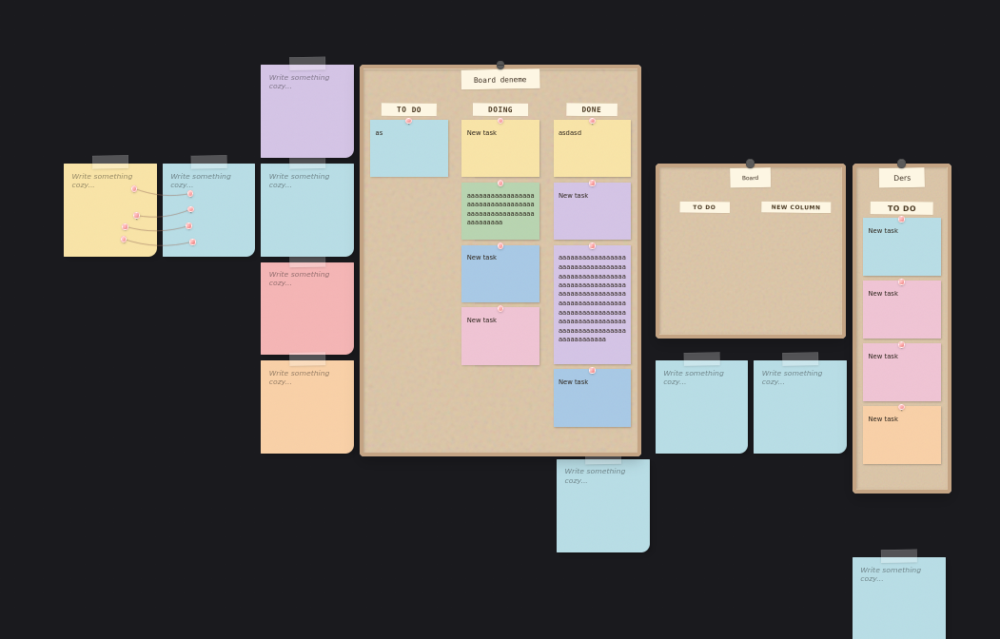

# noty: cozy not-to-do canvas

A calm, infinite-canvas notes app built with React. Sticky notes, kanban-style boards and connections live on one pannable workspace, with a lo-fi player and a zen mode.

> **Status:** Archived. Side project from Nov–Dec 2025, unfinished. About 2.8k lines.



## Features

- Infinite canvas with sticky notes in several colours.
- Boards (e.g. To do / Doing / Done columns) that hold notes.
- Connections drawn between items.
- Rich-text note editor with font size and style pickers, plus a context dock for colours.
- Multiple workspaces saved in `localStorage` (no backend, no account).
- Breathing intro animation, lo-fi music player and zen mode.

## Tech stack

React 18 + Vite, lucide-react icons, plain CSS.

## Run

```bash
npm install
npm run dev      # http://localhost:5173
npm run build    # production build in dist/
```

`rapor.md` is a short project report in Turkish.
